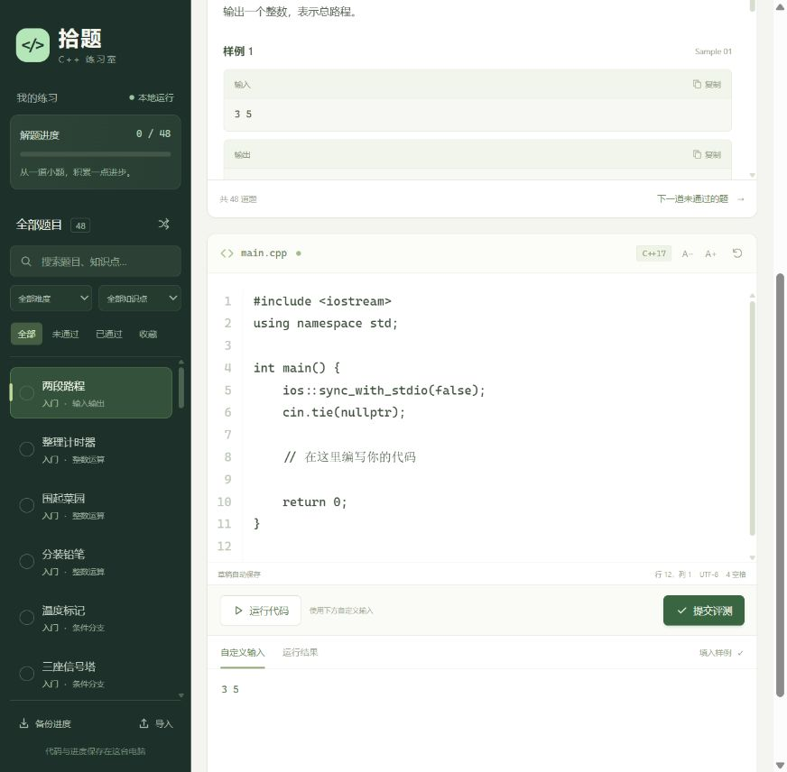

# 拾题 · C++ 练习室

一个中文、离线可用的 C++ 刷题器。在浏览器里读题、写代码，由本机编译器真实编译和判题；代码、笔记和学习记录保存在本地。



## 开始使用

需要 **Node.js 22 或更新版本**，以及支持 C++17 的 **g++（MinGW-w64）**。不需要安装 npm 依赖。

1. 下载或克隆整个项目，并解压到可写的目录。
2. Windows 双击 `start.cmd`，会自动打开练习页面。
3. 选择题目，编写 C++ 代码。点击“运行代码”测试自定义输入，点击“提交评测”检查全部测试。

也可以在项目目录运行：

```sh
npm start
```

关闭启动终端或按 `Ctrl+C` 停止服务。再次启动会保留已有练习记录。

## 功能

- **48 道原创中文题**：入门、基础、进阶三个难度，每题包含样例、提示、解题思路、C++17 参考程序和 6 组测试。
- **本地真实判题**：通过、答案错误、编译错误、运行错误、超时和输出超限；可查看失败用例的输入、期望输出与实际输出。
- **练习工作区**：代码行号、缩进快捷键、字号调整、自定义标准输入、编译诊断与执行输出。
- **学习记录**：每题自动保存独立草稿、收藏、笔记、提交历史和解题进度；按标题、知识点、难度、状态筛选。
- **备份恢复**：导出 JSON 备份，在另一台电脑导入；导入前保留原记录的本地备份。
- **零前端外链**：字体、脚本、样式与题库不依赖 CDN，使用时不需要联网。

题库覆盖：输入输出、分支循环、整数运算、数组、字符串、排序、二分、前缀和、差分、双指针、滑动窗口、栈、队列、贪心、BFS、树与动态规划。

## 编译器设置

应用会检查 `CXX`、系统 PATH、常见 MinGW-w64 安装目录和 CLion 自带的 MinGW 编译器。

如果找不到编译器，可以在 PowerShell 中指定其路径，然后启动：

```powershell
$env:CXX = 'C:\path\to\mingw64\bin\g++.exe'
node server.mjs --open
```

标准固定为 `-std=c++17 -O2 -Wall -Wextra`。参考程序使用 GCC 常用的 `bits/stdc++.h`，推荐 g++；使用 clang++ 时也需要可用的 libstdc++ 头文件。判题执行器会在首次启动时自动编译。

Linux 可使用 `sh start.sh` 或 `npm start`。Windows 已进行真实编译、判题与界面检查；其他系统提供实现与 CI，不代表已经在实体设备上测试。

## 判题规则与运行范围

- 单用例墙钟时间 **2 秒**，标准输出与错误输出合计 **4 MiB**；编译最多 **30 秒**。
- 文本按空白分隔 token 比较，忽略行末空格与空行，不提供浮点误差特判。
- 答案错误后继续检查其余用例；超时、运行错误和输出超限后停止，尚未执行的用例计入总数。
- 程序串行编译执行，最多保留 3 个待处理任务，避免多份代码同时占用机器。
- Windows 使用 Job Object，POSIX 使用进程组清理派生进程。这个工具供个人练习，**不是安全沙箱**；代码拥有当前用户的文件与网络权限，请只运行自己信任的程序。不提供竞赛级内存隔离或精确性能排名。
- 服务仅监听 `127.0.0.1`，包含 Host、Origin 与写请求令牌检查，不能直接作为公开在线判题服务器部署。GitHub 存放源代码，不会在 GitHub Pages 上编译 C++。

## 数据与快捷键

练习记录在项目的 `data/progress.json`，临时编译文件在 `.cache/`，两者均不会提交到 GitHub。导入前的备份在 `data/before-import-*.json`。移动整个目录可保留数据，也可以使用页面中的“备份进度”。删除项目目录前请先备份。

| 快捷键 | 功能 |
| --- | --- |
| `Ctrl+Enter` / `⌘+Enter` | 提交当前代码 |
| `Tab` / `Shift+Tab` | 代码缩进 / 取消缩进 |
| `Esc` 后按 `Tab` | 从代码编辑器移出焦点 |

提交历史最多保存最近 1000 条，保留评测摘要、编译诊断及首个失败用例的截断文本；完整结果显示在当前评测面板。已通过状态由保留的提交历史推导。

## 开发与验证

```sh
npm test
npm run verify:bank
```

`npm test` 使用真实编译器，覆盖判题状态、UTF-8 输入、持久化、备份恢复与请求检查。`verify:bank` 会逐题编译全部参考程序并通过应用的正式判题执行器核验 288 组测试。首次编译执行器的缓存会存入 `.cache/`。

无运行时第三方 npm 包。核心文件：

```text
server.mjs          本机 HTTP 服务、API 和静态文件
lib/problems.mjs    原创题库、参考程序、测试数据
lib/judge.mjs       编译、任务队列、判题
lib/store.mjs       原子写入与备份校验
native/runner.cpp   进程生命周期、时间与输出限制
public/             中文练习界面
tests/              自动集成测试
scripts/            题库完整验证
```

题库与测试数据随源代码公开给仓库使用者，适合学习和自测。代码在 MIT 许可下提供。
